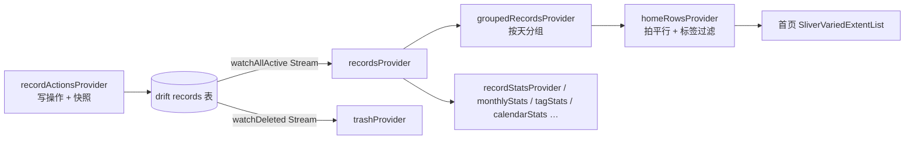

# Vestige 项目学习文档

> **Vestige** 是一个纯本地的记录 App：所有数据只存在设备上、不联网。
> 核心体验是「秒记」——点右下角「速记」按钮立刻记一条今天的；同时把「补记」（事后补交过去的记录）做成一等公民，忘了记不要紧，补上就好。
>
> 本文档面向想系统理解这个项目的开发者，从架构、数据模型到关键设计取舍逐层展开。文中引用的文件路径均相对于 `lib/`。

---

## 目录

1. [项目定位与设计理念](#1-项目定位与设计理念)
2. [技术栈与依赖](#2-技术栈与依赖)
3. [目录结构与分层架构](#3-目录结构与分层架构)
4. [数据模型与数据库设计](#4-数据模型与数据库设计)
5. [数据访问层：DAO 与仓储](#5-数据访问层dao-与仓储)
6. [状态管理（Riverpod）](#6-状态管理riverpod)
7. [撤销系统（Undo）](#7-撤销系统undo)
8. [表现层：路由与页面](#8-表现层路由与页面)
9. [主题系统](#9-主题系统)
10. [CSV 导入 / 导出](#10-csv-导入--导出)
11. [平台适配与文件布局](#11-平台适配与文件布局)
12. [本地化策略](#12-本地化策略)
13. [性能设计要点汇总](#13-性能设计要点汇总)
14. [测试体系](#14-测试体系)
15. [构建与发版](#15-构建与发版)
16. [已知缺口与设计取舍](#16-已知缺口与设计取舍)
17. [推荐阅读顺序](#17-推荐阅读顺序)

---

## 1. 项目定位与设计理念

| 理念 | 说明 | 代码体现 |
|---|---|---|
| **补记是一等公民** | 「这条记录属于哪天」与「这条数据什么时候写进库」是两个独立字段，两者不一致即为补记，全站用琥珀色标记 | `data/database/record.dart`、`domain/day_util.dart` 的 `isBackfilled` |
| **纯本地、零账号** | 无网络请求、无用户系统，数据库文件可整目录备份/搬移 | `data/database/connection/native.dart` |
| **秒记优先** | 右下角「速记」按钮一键记一条今天的内容「速记」；首页列表行高固定、惰性构建，几万条也不卡 | `home_screen.dart` 的 `_QuickNoteButton`、`widgets/row_metrics.dart` |
| **可撤销** | 批量操作先存「操作前快照」再执行，快照落库、跨会话可回退 | `domain/record_snapshot.dart`、`data/database/undo_dao.dart` |
| **视觉延续性** | 由 Kotlin + Compose 版（`D:\projects\vestige-kotlin`）迁移而来，配色 1:1 搬运，行为以原工程为基准 | `app/theme.dart` |

> 注意：原 Kotlin 版的「等级系统（LV0–LV12）」在迁移时已删除，不属于本项目范围。

---

## 2. 技术栈与依赖

| 依赖 | 用途 |
|---|---|
| `flutter_riverpod` | 状态管理：响应式查询流 + 派生数据 + 写操作集合 |
| `drift` (+ `drift_dev`、`build_runner`) | SQLite ORM；响应式 `Stream` 查询（等价 Room 的 `Flow`） |
| `go_router` | 声明式路由；底部三 tab 用 `StatefulShellRoute` |
| `flex_color_scheme` | 主题骨架（子主题统一圆角等），配色本身是手写的 |
| `fl_chart` | 统计页月度柱状图 |
| `shared_preferences` | 主题偏好、搜索历史的持久化 |
| `uuid` | 记录主键生成（clientDefault） |
| `path_provider` / `sqlite3_flutter_libs` | 数据库文件定位与原生 SQLite |
| `share_plus` / `file_selector` | CSV 分享（移动端）与文件选择/另存为（桌面端） |
| `flutter_localizations` | Material/Cupertino 内置组件的中文 |

小字备注：`pubspec.yaml` 里的 `csv` 包当前**未被代码引用**（CSV 解析是 `domain/csv_util.dart` 手写的，为了兼容历史格式的自由度）；`intl` 只随 `flutter_localizations` 间接使用。两者属于可清理项，清理前先跑全量测试确认。

工具链版本：Flutter 3.47.5 / Dart 3.13.4（pubspec 约束 `sdk: ^3.12.2`）/ Java 17 / applicationId `com.rpniu.vestige`。

---

## 3. 目录结构与分层架构

```
lib/
├── main.dart                  # 入口：预读偏好 → ProviderScope → MaterialApp.router
├── app/
│   ├── router.dart            # go_router 路由表 + 底部导航壳
│   └── theme.dart             # 主题：配色、四层表面 token、圆角刻度、buildVestigeTheme
├── data/                      # 数据层（drift）
│   ├── database/
│   │   ├── app_database.dart  # 库定义 + 幂等迁移（schemaVersion = 4）
│   │   ├── record.dart        # records 表 + tags 的 TypeConverter
│   │   ├── undo_entry.dart    # undo_entries 表
│   │   ├── record_dao.dart    # 记录 DAO（查询/软删/搜索/批量平移…）
│   │   ├── undo_dao.dart      # 撤销历史 DAO
│   │   └── connection/        # 平台连接（原生文件 / Web IndexedDB）
│   └── repositories/
│       └── record_repository.dart  # 仓储：封装 DAO + 撤销编排
├── domain/                    # 领域层（纯 Dart，可单测，不依赖 Flutter）
│   ├── day_util.dart          # 时间语义中心：本地日历日、整数天数序号、连续天数
│   ├── calendar_util.dart     # 月历网格构建（纯数据，无 widget）
│   ├── record_selection.dart  # 多选状态机（首页/回收站共用）
│   ├── record_snapshot.dart   # 撤销快照的 JSON 编解码
│   └── csv_util.dart          # CSV 解析/导出（手写解析器）
└── presentation/
    ├── providers/             # Riverpod：数据源、派生数据、写操作、编辑页状态
    ├── screens/               # 页面：home / stats / profile / edit / search / trash
    ├── widgets/               # 复用组件：记录卡、柱图、日历、弹层、行高…
    └── services/              # 平台服务：CSV 落盘（原生/Web 条件导出）
```

**依赖方向规则**（读懂代码前先记住这三条）：

1. `domain/` 是纯 Dart —— 唯一允许的向下依赖是 `data/database` 里的 **实体类型**（`RecordEntity`），绝不 import Flutter；
2. `presentation/` 通过 Riverpod 拿数据，**写操作一律走 `recordActionsProvider`**，不直接碰 DAO；
3. 平台差异（数据库连接、CSV 落盘）收敛在 `connection/` 与 `services/` 的**条件导出**文件里，上层无感知：

```dart
export './native.dart' if (dart.library.html) './web.dart';
```

---

## 4. 数据模型与数据库设计

### 4.1 records 表

`data/database/record.dart`，drift 表名 `Records`，生成数据类 `RecordEntity`。

| 列 | 类型 | 语义 |
|---|---|---|
| `id` | TEXT PK | UUID 字符串（clientDefault `Uuid().v4()`）；存字符串是为了路由参数与 CSV 免转换 |
| `title` | TEXT? | 标题，可空 |
| `content` | TEXT | 正文，必填（`canSave` 以它非空为准） |
| `tags` | TEXT | `List<String>` 的 JSON（`TagsConverter`），避免旧版逗号串在标签含逗号时错位 |
| `recordedAt` | INTEGER | **业务日期**：这条记录「属于」哪天。可编辑、可回填 |
| `createdAt` | INTEGER | **入库时间**：落库时刻。创建后永不修改，用于识别补记与审计 |
| `updatedAt` | INTEGER | 最后修改时间；回收站列表按它倒序 |
| `deleted` | INTEGER | 软删标志 |
| `deletedAt` | INTEGER? | 进回收站的时刻；恢复时清回 null（重新计时） |

索引：`idx_deleted`（回收站/活跃过滤）、`idx_recorded_at`（几乎所有列表/统计的排序键）。

**核心设计：一条时间戳拆成两条。** 旧设计只有 `createdAt`，同时承担「属于哪天」和「什么时候写的」两个冲突语义，补记只能靠改 `createdAt` 实现，把审计信息也一起改坏。拆分后的取用规则：

| 用途 | 用哪个字段 |
|---|---|
| 列表分组、统计图、连续天数 | `recordedAt` |
| 补记判定 / 审计 | `createdAt`（两者不在同一个本地日历日即补记） |
| 回收站排序 | `updatedAt` |

**为什么 `deletedAt` 单独一列而不复用 `updatedAt`**：`updatedAt` 是「最后一次改内容的时刻」，发生在删除**之前**。拿它当删除时间，一条半年前写的、昨天才删的记录会被算成「在回收站放了半年」。

### 4.2 undo_entries 表

`data/database/undo_entry.dart`。每行 = 一次操作 + 它**操作前**受影响记录的整行快照（JSON，见 `record_snapshot.dart`）：

| 列 | 语义 |
|---|---|
| `id` | 自增主键；rowid 顺序即历史顺序，「比某步更新」的判据 |
| `label` | 给用户看的操作名（「移入回收站」） |
| `createdAt` | 操作时刻（列表显示「N 分钟前」） |
| `snapshot` | 操作前整行快照 JSON |
| `recordCount` | 快照条数（冗余存储，列表「影响 N 条」不用逐行解析 JSON） |

### 4.3 schema 迁移史（v1 → v4）

`app_database.dart` 的 `schemaVersion = 4`：

- **v1**：单时间戳 `createdAt`；
- **v2**：拆出 `recorded_at`，升级时把既有记录回填 `recorded_at = created_at`（旧数据全部按当时时间算，不判补记），并建索引；
- **v3**：加 `deleted_at`（软删时刻），既有软删记录用 `updated_at` 尽力回填；
- **v4**：纯新增 `undo_entries` 表，无数据风险。

**迁移必须幂等** —— 这是本项目最重要的数据库经验：库文件可能处于「列已经在、`user_version` 却没跟上」的中间态，无条件 `ALTER TABLE ADD COLUMN` 会抛 duplicate column，迁移从此每次打开都失败，全部查询静默报错（首页空列表，像数据丢了，且 logcat 无输出）。所以每一步迁移都先 `_columnExists` / `_tableExists` 探测再动手；索引用 `CREATE INDEX IF NOT EXISTS` 天然幂等。新增迁移请沿用这个模式。

---

## 5. 数据访问层：DAO 与仓储

### 5.1 RecordDao（`data/database/record_dao.dart`）

- 所有列表/排序一律按 **recordedAt** 倒序，同天再按 createdAt 倒序（补记的排在当天入库顺序末尾，符合「补交」直觉）；
- `watch*` 前缀 = 响应式 `Stream`（drift 的表级通知：写入后自动重查并推给 UI）；
- `searchActive`：标题/正文/标签 LIKE 包含匹配。要点：
  - `\` `%` `_` 先转义再拼模式串（否则搜「100%」变成「100 开头的一切」）；
  - 日期范围**左闭右开** `[from, to)`，调用方传下月 1 号零点即可，不用算「月末最后一秒」；
  - 关键词与范围都为空时直接返回空（防全库拖出）；`limit` 默认 200（逐键触发的搜索，返回几万条没有意义）；
- `shiftRecordedAt`：批量平移业务日期走**一条裸 SQL UPDATE**（`recorded_at + ?`）。drift 的 `update().write()` 只能写字面值表达不了「原值 + 增量」；旧写法逐条查+写是 2N 次语句。注意 `customUpdate` 必须带 `updates: {records}` 才会通知依赖的 stream；
- `updateTagsMany`：批量改标签每行结果不同（各自并上已有标签），SQL 表达不了，于是逐条写但包在 `batch`（单事务）里，避免「一半改了一半没改」的中间态；
- `restoreRows`（撤销写回）：**先 UPDATE、0 行再 INSERT**，不能用 drift 的 `insertOnConflictUpdate` —— 后者对「显式置 null」的列不生效，撤销「移入回收站」后 `deleted_at` 会残留旧值。INSERT 分支是「撤销清空回收站」能救回记录的关键。

### 5.2 RecordRepository（`data/repositories/record_repository.dart`）

对上层屏蔽 DAO；两条关键约定：

- `addRecord` 的 `createdAt` 恒为「现在」（clientDefault 写入），`recordedAt` 由调用方给 —— 补记能力的数据基础；CSV 导入是唯一允许显式写 `createdAt` 的入口；
- 编辑既有记录不动 `createdAt`。

批量标签 `applyTags`：先读目标行 → Dart 内逐行算并集/差集 → 没变化的行**不写库**（避免无谓推新 `updatedAt`）→ DAO 单事务写回，返回真正改动的条数。

**撤销编排**也在这层（`pushUndo` / `undoUpTo`，详见 §7）。注意 `_undo` 是**手动构造** `UndoDao(_dao.db)`：一旦把 `UndoDao` 写进 `@DriftDatabase(daos: [...])`，drift 会静默地一个 DAO getter 都不生成（连原有的 `recordDao` 一起消失）。这是 drift 的真实坑，别改回去。

---

## 6. 状态管理（Riverpod）

### 6.1 Provider 总览与数据流



- **数据源**：`recordsProvider` / `trashProvider` 是 `StreamProvider`，直接订阅 DAO 的 watch 流。任何写入（含导入、撤销）都会自动推给 UI，全应用没有一处手动 `refresh`；
- **派生数据**：分组、统计、标签计数全是 `Provider`，只在数据变化时重算一次（多选 setState 不触发重算）；
- **读写分离**：所有写操作收敛在 `recordActionsProvider`（`RecordActions` 类），UI 里 `ref.read(...).xxx()`。可撤销操作统一走私有 `_undoable()`：先取快照、再执行、按需记历史 —— 新增批量操作只要走它，撤销能力自动获得；
- `core_providers.dart` 提供 `appDatabaseProvider`（容器销毁时 `db.close()`）与 `recordRepositoryProvider`。

### 6.2 几个值得注意的 provider 设计

| Provider | 设计点 |
|---|---|
| `homeRowsProvider` | 把「分组头 + 卡片」拍成扁平行列表。若按「一天一个列表项」，进入屏幕时那一天几百条会在**同一帧**全建出来；拍平后每张卡吃到 sliver 惰性构建。标签筛选在分组之后过滤，空组整组消失，**多选语义是「或」** |
| `effectiveTagFilterProvider` | 勾选的标签可能随记录一起被删掉，失效项自动剔除（全失效 = 无筛选） |
| `shownYearProvider` | 「真正展示的年份」只判定一次：选中的年份可能已从可用列表消失（记录全删了），药丸、柱图、合计都读它，三者不可能各说各话 |
| `editRecordProvider` | autoDispose family，key 约定：记录 id = 编辑；`new` = 新建；`new@yyyy-MM-dd` = **补记入口**（预置业务日期、保留当前时刻）。记录在别处被删时退回新建态，避免白屏 |
| `searchHistoryProvider` | 只记**执行过**的搜索（不记敲了一半的中间态），重复词提到最前，上限 10 条 |

---

## 7. 撤销系统（Undo）

### 7.1 为什么是「快照」而不是「反向操作」

- 反向操作对**并集**类语义是错的：批量加 `#A` 的反向是去掉 `#A`，但某条本来就有 `#A` 的记录，加的时候是空操作，撤销却会把它删掉；
- 「彻底删除」根本没有反向操作。

快照 = 操作前整行 JSON（`record_snapshot.dart` 手写编解码，带版本号；单条解析失败只跳过那一条，不让整个历史打不开）。撤销 = 回到操作前的状态，字面意义。

### 7.2 为什么落库而不是内存

最痛的场景恰恰是「当时没反应过来」：昨天清空了回收站，今天才发现。内存快照关掉 App 就没了，所以 `undo_entries` 是数据库表。

### 7.3 回退算法（`RecordRepository.undoUpTo`）

```
点第 N 步「回退」→ 把 N 及比 N 更新的所有步骤一起回滚
  （历史是链，中间抽一环后面的状态就对不上）
→ 各步快照按「新 → 旧」合并，同一条记录取【最旧】那份
  （那才是这些操作都没发生过时的状态）
→ 整行写回（restoreRows：UPDATE，0 行则 INSERT）
→ 删除这些历史条目
```

### 7.4 产品层面的约定

- 上限 **20 步**，**没有时间过期**（历史一直保留，用户明确要求不要自动清理）；
- 「恢复」不记历史（非破坏性，再删一次就行）；改了 0 条的批量标签也不记（`shouldKeep`）；
- 删除单条/清空历史只抹掉回退点，**不动记录数据**；
- 带撤销按钮的 SnackBar 必须**显式 `persist: false`**（否则带 action 的提示条默认永不消失），时长统一 3 秒 —— 敢给这么短就是因为有「操作历史」兜底；
- 入口：SnackBar「撤销」只退最近一步；「我的 → 操作历史」**独立页面**可退到任意一步之前。

### 7.5 已知取舍

撤销是「整行写回」：回退一条**旧的**批量操作，会把这批记录**之后**的其他修改一起抹掉。这是快照模型的固有取舍，不是 bug；UI 的确认弹窗（「一并回退更新的操作？」）已经把这件事讲给用户。

---

## 8. 表现层：路由与页面

### 8.1 路由（`app/router.dart`）

| 路由 | 位置 | 说明 |
|---|---|---|
| `/home` `/stats` `/profile` | `StatefulShellRoute.indexedStack` 三个分支 | 各自保留导航栈与滚动位置；再次点击当前 tab 回到该分支初始页 |
| `/edit` `/edit/:id` | 根导航器整页推入 | `/edit?day=yyyy-MM-dd` 为**补记入口**（预置业务日期） |
| `/trash` | 根导航器 | 回收站 |
| `/search` | 根导航器 | 全文搜索 |

编辑/搜索/回收站挂根导航器以整页盖住底部栏，与原 Compose 版行为一致。

### 8.2 首页：声明式行高 + 算术定位跳转

首页列表是本项目最有含金量的性能设计（`home_screen.dart` + `widgets/row_metrics.dart` + `widgets/record_card.dart`）：

1. **行高唯一来源**是 `VestigeRowMetrics`（常量刻度：卡片文字两档高度、分组头、间隙、亚像素余量）。卡片渲染读它声明行高，sliver 也读它声明行高，两边永远对得上；
2. 列表用 `SliverVariedExtentList` + `itemExtentBuilder`：行高**提前声明**后，跳转是算术定位，不用逐行布局。代价是卡片内容被约束成「标题 1 行 + 正文最多 2 行 + 元信息 1 行」，超出省略号；
3. `itemExtentBuilder` 是热路径（每帧 O(index) 次调用），所以行高**预计算成 `Float64List`**，回调里只剩一次数组读取；
4. 效果：6000 条记录「一键到底」，旧实现（逐行布局）要烧 5.4s CPU、首帧卡 700ms；新实现跳转动画 320ms 内恒定只构建可见的约 20 行；
5. 卡片形状判定（有无标题/元信息 → 紧凑档/完整档）由 `RecordCardShapeX` 扩展提供，**行高与渲染共用同一份**，判定不一致就会裁内容，所以只能有一处。

### 8.3 多选：RecordSelection 状态机（`domain/record_selection.dart`）

首页与回收站共用的纯 Dart 状态类（不依赖 Flutter，可直接单测）：

- **显式开关**：`isActive` 不由「勾选是否非空」推导 —— 取消全选不该连带退出多选（历史上真实出过这个 bug）；
- **候选集 = 当前可见的记录**（首页是筛选后的行，回收站是全部）：三态全选框的判据和批量操作的靶子都是它，勾选集永远是候选集的子集 —— 否则「移入回收站」会删掉用户没看见的记录；
- `prune()`：记录被删/被筛掉后清理失效勾选。只读预检（`hasStale`）在 build 里做，真正的清理放 post-frame（build 期间不改状态）；
- 三态 checkbox 的回调值**不能信**（传的是循环下一值），要按当前状态判断；
- 多选态下 `PopScope` 拦截系统返回：先退多选，不是退页面。

### 8.4 其余页面速览

| 页面 | 要点 |
|---|---|
| **编辑页** `edit_screen.dart` | 补记的核心交互：记录日期卡内置「今天记 / 记过去」分段开关 + 昨天/前天/上周今天快捷 chip；时间面板只有日历/时钟两条图形化入口（数字键盘输入已删除）；保存栏钉在 `bottomNavigationBar`（键盘弹起时被顶到键盘上方）；`_pickDate` 的 `lastDate` = 今天（不允许记未来） |
| **统计页** `stats_screen.dart` | 月度柱图（`monthly_bar_chart.dart`：按 4 的倍数取整量程、柱顶数字余量、补记琥珀分段）+ 记录日历热力图（`record_calendar.dart`：相对当月最大条数着色、限宽 430）+ 标签分布（相对比例条，非占比 —— 多标签各项相加超 100%）+ 记录习惯卡（4 格等宽，**窗口口径**：近 N 天条数 / 其中补记 / 有记录天数 / 日均条数，7/30/90 窗口可选，四个数字都随选择器一起变） |
| **搜索页** `search_screen.dart` | 280ms 防抖 + 过期结果丢弃（比较提交时的关键词/范围与当前值）；日期范围闭区间 → 仓储左闭右开在页面内转换；从编辑页返回后按当前条件重搜 |
| **回收站** `trash_screen.dart` | 软删记录列表，卡片常驻复选框（点卡片即勾选）；恢复不记历史；彻底删除/清空需确认且**可撤销**（快照在清空之前取） |
| **操作历史** `undo_history_screen.dart` | 由「我的」推入的整页（`/undo-history`），内容复用 `widgets/undo_history_sheet.dart`；单条/批量回退、单条删除（不确认）、清空（二次确认）。原先是一个居中弹层 |
| **我的** `profile_screen.dart` | 主题（两套配色 × 三种模式）、CSV 导入导出、操作历史入口、关于弹窗。导出走「桌面另存为 → 移动/Web 临时文件 + 系统分享」两级降级 |

### 8.5 弹层统一语言

全站模态选择统一为**居中 Dialog**（`widgets/center_dialog.dart` 的 `showVestigeCenterDialog`）：底色/32 圆角/裁剪来自 `dialogTheme`；内容最大高 = 屏高 × 0.6；内容组件自带「左标题 + 右动作」标题行与 `shrinkWrap` 列表；行尾的「N 条」/勾选位每行固定宽度对齐。（早期底部 `showModalBottomSheet` 方案已全部替换。）

---

## 9. 主题系统

`app/theme.dart`，三个关键抽象 + 一套手写配色：

### 9.1 VestigeSurfaces —— 四层表面（ThemeExtension）

| token | 角色 | 用在哪 |
|---|---|---|
| `base` | 页面底 | Scaffold / AppBar 背景 |
| `card` | 容器面 | 卡片、底部导航栏、输入框填充 |
| `inset` | 卡内凹槽 | 时间徽标底座、数字格 |
| `border` | 容器描边 | 很淡，只负责收边 |

**为什么强制实色**：旧版用 `withValues(alpha:)` 叠半透明，卡片与页面底明度差不到 3%，整屏糊成一片灰、深色模式更糟。现在四层实色拉开一档明度差，卡片真正「浮」起来。**页面里不要再用半透明调底色**（首页记录卡选中态是唯一允许自写 Card color 的例外）。

### 9.2 VestigeRadius —— 五档圆角刻度

`inset 12`（卡内小方块）→ `small 16`（输入框/按钮/chip）→ `medium 24`（卡片）→ `large 32`（弹层）→ `pill 999`。规则：**元素越外层、圆角越大**。页面一律从这里取，不再散落自定义圆角。

### 9.3 VestigeTokens —— 补记语义色

`backfill` / `backfillContainer` / `onBackfillContainer`（琥珀色系），浅深两套。全站「补记」标记（卡片元信息、日历格上的点、洞察卡高亮格）统一用它。

### 9.4 buildVestigeTheme 的两个深坑

1. `ColorScheme` 是手写的（只列了部分角色），**没配到的角色（`surfaceContainerLow/High` 等）会静默落回 Material 3 baseline 的紫灰** —— 弹层、日历/时钟选择器必须显式配底色；
2. `timePickerTheme` **不要覆盖** `hourMinuteColor` / `dayPeriodColor`：它们默认是 `WidgetStateColor`（选中态用 primaryContainer），覆盖成实色会把选中高亮抹掉。

---

## 10. CSV 导入 / 导出

`domain/csv_util.dart`（纯 Dart、手写解析器、完整单测）。

**导出**：7 列 `ID,Title,Content,Tags,RecordedAt,CreatedAt,UpdatedAt`；时间统一毫秒时间戳；标签在 CSV 内用 `;` 分隔；**UTF-8 with BOM**（Windows Excel 双击打开不乱码）。

**导入**（先解析 → 预览确认 → upsert）：

| 输入形态 | 处理 |
|---|---|
| 新 7 列 | 按表头名匹配（大小写/分隔符归一） |
| 旧 6 列（无 RecordedAt） | CreatedAt 同时当业务日期与入库时间 → 旧数据不会被误标补记 |
| 裸数据无表头 | 7 列按新顺序、6 列按旧顺序 |
| 时间格式 | 兼容毫秒/秒级时间戳（< 1e10 视为秒）与 ISO-8601 |
| 编码 | 严格 UTF-8 失败 → 容错解码并标记「可能乱码」，预览框提示 |

落库走 `upsertAll`（同 id 覆盖、新 id 插入），导入幂等。**导出不含回收站**（`getAllActiveRecordsSync` 只取活跃记录），见 §16。

---

## 11. 平台适配与文件布局

### 11.1 数据库连接（`data/database/connection/`）

- 原生：`NativeDatabase.createInBackground` 包在 `LazyDatabase` 里；文件 `<文档目录>/vestige/vestige.sqlite`；
- Web：`WebDatabase('vestige')`（IndexedDB）；
- 环境变量 `VESTIGE_DATA_DIR` 可覆盖数据目录（Windows + WSL 等多系统共用同一份数据时用），优先级最高；
- `_adoptLegacyFile`：旧版库文件直接躺在文档根下，新位置为空且旧位置有库时自动 `rename` 进子目录（跨设备失败退回复制）——避免「升级后打开一片空白，用户以为数据丢了」。

### 11.2 CSV 落盘（`presentation/services/`）

桌面端 `file_selector` 原生另存为；Android/iOS 写临时文件交给 `share_plus` 系统分享；Web 无文件系统，恒回退「分享 CSV 文本」，由浏览器承担下载。

---

## 12. 本地化策略

- App 自身文案**硬编码中文**，`supportedLocales` 只声明 `zh_CN`（声明 en_US 等于对外声称支持英文而实际做不到）；
- 但 `GlobalMaterialLocalizations` / `GlobalWidgetsLocalizations` / `GlobalCupertinoLocalizations` 三个 delegate **必须保留** —— 它们负责 Material/Cupertino **内置组件**的中文（日期选择器的「确定/取消」、时钟的「上午/下午」等），删掉后编辑页的弹层会变英文（`edit_time_panel_test` 会当场失败）。

---

## 13. 性能设计要点汇总

| 决策 | 依据 |
|---|---|
| 天数比较用整数序号 `dayNumber()`（Hinnant `days_from_civil` 算法） | `DateTime(y,m,d)` 本地构造 ≈ 23 µs/次（向 OS 问时区）；整数运算 ≈ 0.05 µs，快约 500 倍，且天然免疫夏令时截断 |
| 分组/统计循环里避免闭包分配 | `putIfAbsent(k, () => [])` 每条记录分配一个闭包；几万条就是几万个短命对象 |
| 首页拍平行 + `SliverVariedExtentList` + 预计算行高数组 | 跳转从 O(总行数) 到 O(可见行)：6000 条时 5.4s → 320ms（`test/perf/scroll_jump_bench_test.dart`） |
| 批量日期平移一条 UPDATE；批量标签 `batch` 单事务 | 2N 次独立语句 → 1 条语句；消除中间态 |
| `buildDailySeries` 先滤窗口外记录再分桶 | 免掉为 99% 窗口外记录建桶又丢弃 |
| 日历 `DateTime` 构造每月只发生两次 | 非热路径不优化，保持可读 |

性能基准在 `test/perf/`，默认带 `skip` 标记，显式运行：`flutter test --run-skipped test/perf/`。

---

## 14. 测试体系

```
test/
├── unit/…      # domain 层纯函数（day_util、csv_util、record_selection…）
├── dao/…       # drift DAO（内存库 NativeDatabase.memory()，如 record_dao_trash_test）
├── widget/…    # widget 测试（home_fixed_row_test、year_picker_test、
│               #   edit_time_panel_test、insight_card_test…）
└── perf/…      # 基准测试（默认 skip，--run-skipped 运行）
```

约定与技巧：

- 内存库测试用 `VestigeDatabase(NativeDatabase.memory())`；
- `RecordCard.debugBuildCount`（仅测试用，包在 `assert` 里 release 零开销）钉住「跳到底只构建可见行」的回归；
- 行高改动必须同步 `VestigeRowMetrics`，`home_fixed_row_test` 会盯住「内容不许溢出给定行高」；
- 中文 UI 的 widget 测试无需 i18n —— 文案是硬编码的；但涉及日期/时间选择器的测试依赖三个 Global delegate；
- `RecordStats.from` / `friendlyDayLabel` / `undoAgoLabel` 等都接受可注入 `now`，让时间相关断言稳定。

---

## 15. 构建与发版

- **版本**：以 tag 为准 —— `v1.2.3` 或 `v1.2.3+5` 触发 CI，构建时从 tag 解析并覆盖 pubspec 版本；
- **门禁**：`verify`（analyze + 全量 test）不过不出包；
- **签名**：4 个 GitHub Secret；keystore 的 base64 用 `base64 -w0` 生成（`-w0` 不能省）；
- `*.g.dart` 不入库，克隆后先 `dart run build_runner build --delete-conflicting-outputs`；
- 忽略规则：`.workbuddy*/`、`vestige_export_*.csv`、`*.sqlite*`、`key.properties` 等（用 `git add -A --dry-run` 验证）。

本机（Windows）开发备忘：

- 跑 flutter/dart 命令前先 `unset http_proxy https_proxy HTTP_PROXY HTTPS_PROXY`；
- 本机存在安全软件按进程身份拦截 dart.exe 命名管道（OS error 231「管道实例全忙」）的问题：本地 dart 工具链可能起不来，此时依赖 CI verify 或重启机器，不要反复重试浪费时间；
- `gradle.properties` 的 `kotlin.incremental=false` 不可删（跨盘符构建会崩）；
- 数据库文件默认在 `<文档目录>/vestige/vestige.sqlite`，只读排查用 sqlite3 的 `mode=ro` URI。

---

## 16. 已知缺口与设计取舍

| 事项 | 性质 |
|---|---|
| **导出不含回收站** | 已知缺口：`exportCsv` 走 `getAllActiveRecordsSync`。「导出 → 清数据 → 导入」会丢掉回收站内容。修复方向：导出带 `deleted` 列并让导入尊重软删状态 |
| **撤销整行写回会连带抹掉后续修改** | 快照模型的固有取舍（见 §7.5），UI 已做确认提示 |
| `csv` 包未使用 | 依赖冗余，可清理 |
| `undoAgoLabel` 的「30 天前」封顶 | 超过一个月直接显示日期，属有意为之 |

---

## 17. 推荐阅读顺序

按下面顺序读代码，每一步都建立在前一步之上：

1. **`data/database/record.dart`** —— 一切的起点：recordedAt / createdAt 的时间语义；
2. **`domain/day_util.dart`** —— 补记判定与整数天数序号，理解性能风格；
3. **`data/database/app_database.dart`** —— 库定义与幂等迁移模式；
4. **`data/database/record_dao.dart` + `record_repository.dart`** —— 查询与写入的完整链路（留意 `shiftRecordedAt` 与 `restoreRows` 的注释）；
5. **`presentation/providers/records_provider.dart`** —— provider 图与 `_undoable` 写操作骨架；
6. **`domain/record_snapshot.dart` + `record_repository.undoUpTo`** —— 撤销闭环；
7. **`presentation/screens/home_screen.dart` + `widgets/row_metrics.dart` + `widgets/record_card.dart`** —— 最有含金量的 UI 性能设计；
8. 最后按需翻 `stats_screen`（图表）、`csv_util`（格式兼容）、`theme.dart`（视觉体系）。

配套验证：改任何数据层代码后跑 `flutter test`；改性能相关代码后跑 `flutter test --run-skipped test/perf/` 对比基准。
